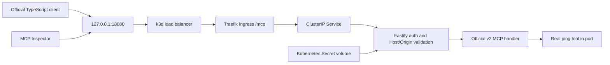

# Relay architecture

Current release: M0–M6 are implemented and tested locally, including the real two-user core, durable multi-store lifecycle, native OAuth, live permissions and TLS/vault/network/admission hardening. M10 evidence repeats the actual journey and clean installation. The milestone sections below preserve historical snapshots; their earlier pending/HTTP descriptions do not describe the current TLS release. M7–M9/C1–C10 remain longer-term roadmap work.

This repository implements a persistent WooCommerce store, three independent private MCP upstreams, the durable authenticated gateway and management API, and the preserved transport proof. PostgreSQL owns identity, registry and audits; Redis enforces shared admission limits. Dashboard and model chat remain M4. The full assessment scope is tracked in [REQUIREMENTS.md](../REQUIREMENTS.md). Future-only directories contain explicit unimplemented notices.

## Preserved M0 transport proof

The following describes the original isolated proof, not the M3 user authentication path.

The Secret is generated locally, ignored by Git and mounted read-only. Its reference, not its value, appears in the chart. The handler compares the presented bearer credential without logging it. This is a bounded M0 credential test; hashed personal keys, users, teams, revocation and audit are now implemented separately in M3. No upstream credential forwarding exists at M0 because there are no upstreams.

The SDK owns Streamable HTTP, discovery, JSON-RPC tools, schemas and modern/legacy wire behavior. A factory creates a fresh server per request. Fastify passes the parsed body to the Node adapter, preventing a second read of the consumed stream. The adapter takes over the response through `reply.hijack()`. Node’s optional method/url declarations are refined from the routed Fastify request without disabling strict checks.

The modern client explicitly chooses automatic era negotiation; a second run explicitly uses legacy negotiation. M0 registers a tool named `ping`; this is not the protocol-level liveness `ping` method. The observed revision/era is recorded in actual client evidence rather than inferred from the package major version.

M0 runs one k3s server inside Docker with a 3 GiB container memory limit, bundled Traefik, local-path storage and Secret encryption enabled. This single-machine proof establishes no HA guarantee. The dedicated kubeconfig does not change the owner’s default context. Only loopback port 18080 is exposed; local HTTP is not claimed to be TLS. Namespace policy permits Traefik and explicitly labelled proof clients, rejects other pod ingress and denies proof-server egress.

Later milestones retain the researched boundaries: React dashboard → control API/session → gateway → handwritten WooCommerce and two independent MCP upstreams; PostgreSQL identity/catalog/audit state; a separate restricted provisioner only at M5. M0 did not implement the store. M1 adds only the store; dashboard, production OAuth, multi-store provisioning and product model chat remain pending.

References: [SDK v2 Fastify integration](https://ts.sdk.modelcontextprotocol.io/v2/serving/fastify.html), [protocol eras](https://ts.sdk.modelcontextprotocol.io/v2/protocol-versions.html), [K3s networking](https://docs.k3s.io/networking/networking-services), [Secret encryption](https://docs.k3s.io/security/secrets-encryption). See exact packages and image identities in [versions.md](../versions.md).

## M1 store path

Browser → loopback k3d port 18080 → Traefik hostname `store.relay.localhost` → store ClusterIP → WordPress/WooCommerce → dedicated MariaDB. WordPress files and database use separate retained PVCs. A post-install/upgrade Helm Job mounts setup Secrets and configures the real store; WordPress runtime mounts DB password/signing salts, with no adapter/admin Secret. Future private adapter gets its own REST Secret.

The local REST verification follows the same Ingress with OAuth HMAC-SHA256 Authorization headers. Canonical hostname/port participate in signature calculation; the command-line client uses `node:http` to preserve Host while connecting to loopback. Node 24's fetch did not preserve that override in the tested path and returned Traefik 404, so it is not used for this test. Native Chrome resolves `.localhost` directly. Real classic checkout creates a WooCommerce HPOS order; administration and REST see the same ID.

The store chart is single-replica, RWO and Recreate. It intentionally uses upstream root initialization and writable image roots; actual process ownership and limits are in M1 inventory. Default-deny namespace policy allows only required DNS/Traefik/own-DB flows. No public database route exists. This is a single-store foundation, not multi-store isolation, database backup/restore or HA. See ADR 0006 and the M1 runbook/evidence. Production same-chart values render, but actual VPS/TLS/amd64 execution remains pending.

## M2 upstream path

A privileged gateway-labelled acceptance pod in relay-platform → ClusterIP Streamable HTTP → separately authenticated Woo/Calendar/Totals deployment. Only Woo → its WordPress service → its MariaDB is permitted. Utilities cannot reach WordPress/DB. No MCP upstream has an Ingress, NodePort, external IP, Kubernetes service-account token or user-session identity. Servers run uid/gid 1000, read-only roots, separate tokens and bounded resources. The Woo adapter alone mounts the existing store-adapter Secret; the fixture client sees only upstream tokens.

Each deployment starts one program from the pinned shared runtime image. The SDK implements stateless modern and legacy MCP; strict Zod contracts, exact decimal/date helpers and a fixed-origin HTTP REST client supply domain behavior. Handwritten Woo tools expose five required operations plus info. Calendar and Totals each provide two useful tools plus info. A pure collision-safe route helper is exercised against all three real info tools, but the dynamic authenticated production gateway is still M3. The actual multi-server SDK sequence is not an autonomous model prompt; that remains M4.

See ADR 0007, the upstream runbook and M2 evidence for actual protocol/security/failure checks. HTTP inside the local cluster is restricted but unencrypted. HTTPS REST configuration, public TLS/VPS and production identity/policy remain unverified work. All full-plan scope remains active.

## M3 platform path

The initial paragraphs above describe preserved milestone snapshots. The production-path implementation now adds: named Ingress → session API or personal-key/delegation gateway → current team/registry/policy and audit admission → official MCP client → chosen private Woo/Calendar/Totals service. PostgreSQL owns identity/teams/keys/registry/catalog/audit; Redis supplies shared admission limits. The API and gateway are separate Kubernetes deployments. PostgreSQL and Redis have PVCs; runtime Secret mounts and one-resource Secret-manager RBAC are distinct from the migration owner.

The API's private delegation route derives identity from Better Auth. The gateway verifies it against current session/membership. The API's private credential route resolves only a team-bound enabled registration's reference. Caller authentication never becomes upstream authentication. Real output/errors are bounded and validated, and a persisted audit correlation accompanies tool results. The dashboard and actual model-driven product chat are M4; the tested trusted delegation foundation is not advertised as a completed chat UI.

See [ADR 0008](../decisions/0008-durable-gateway.md), [local platform runbook](../runbooks/local-platform.md) and [M3 evidence](../evidence/m3.md). All M0–M10, differentiator and expansion scope remains active.

## M4: console and real model path

The separate unprivileged dashboard pod serves the compiled React SPA behind a low-priority root Ingress. Existing /api and /mcp routing retain priority. Dashboard has no Secret mounts, Kubernetes token or outbound network access. Better Auth's HTTP-only browser session authenticates the API; team membership is freshly checked and server-side permissions remain authoritative.

API persists owner-scoped chat runs/events under tenant RLS, admits one bounded active run per user, and reserves the shared prepaid budget in PostgreSQL before each provider request. Only the API mounts the Gemini Secret. The provider adapter validates the official host/model/request size/output cap and disables retries and paid auxiliary tools. MCP discovery and execution always use the official client against the gateway with a short-lived session-derived HMAC delegation. The model cannot supply an actor or bypass the gateway. Gateway checks active membership/tool policy and writes durable audits; every actual tool result carries its audit ID.

The independent external CLI model host runs outside Kubernetes using B's personal gateway key. Its operator separately supplies the model provider key and shared budget guard; the MCP configuration contains no upstream credentials. Independent Inspector compatibility is a separate test. This is not a claim that a Claude/Cursor/Gemini branded host was installed.

Chat history is durable but each selected run is an independent turn, not an unbounded conversational memory. Cancellation is local to the active API process and interrupted writes remain uncertain; cross-replica cancellation and advanced tracing belong to later work. The current execution inspector does not satisfy all C1 Flight Recorder criteria. Budget reservations are conservative ceilings, not a billing invoice. Optional legacy SDK GET returning 405 is correctly represented as a rejected HTTP attempt, not a successful tool execution.

A separate dashboard Ingress fixes root-route shadowing. Soft-deleted upstream names may be reused through a partial unique index while immutable IDs preserve historical audits and collision-safe aliases. M3 and M4 migrations are both required for API readiness. Production configuration uses the same charts with environment overrides; actual public TLS/VPS/failure-domain validation remains D01/M9.

## M5 — Store orchestration

`apps/provisioner` is now a real private controller, with PostgreSQL stores/operations/outbox/events, BullMQ database1 dispatch, per-store locks/leases/generation checks and isolated store/adapter Helm releases. SQL remains authoritative after a queue restart, lost published work or a failed queue job. Admission is per owner across teams; the default global queue concurrency is two. Credentials are generated in owned namespace Secrets, captured image configuration is durable, and persisted stores with missing credentials fail safely. See ADR0010 and the multi-store runbook.

Dashboard `/stores` reads durable lifecycle data from the API and sanitized Kubernetes observations through the private controller. The API verifies current session/membership and tenant ownership before requesting an observation, then filters tool names with the same permission engine as the gateway. The API does not receive broad Kubernetes read access. The controller's namespaced resource role adds read-only Metrics API access for measured CPU/memory. Responses omit Secret data, environment values and host storage paths. Observations are cached for five seconds and labelled with timestamps; unavailable metrics/health remain explicit. Polling is2.5seconds for lifecycle and10seconds for observations/discovery, not an unproven streaming claim.

Deletion denies routes transactionally, drains bounded calls, uninstalls releases, removes and verifies namespace/PVC/PV state, clears the gateway credential slot and only then records Deleted. Local-path data directory absence is an additional operator acceptance check. No production code strips finalizers. Managed store aliases preserve full UUID identity, and existing core aliases remain stable.

## M6 — live permissions, native OAuth and service trust

The gateway applies persisted default/role/user/server/tool policy to discovery, search and cached direct calls for API keys, OAuth and server-derived chat delegation. Deny wins. Management checks resolve current membership/session after the tenant lock; execution permissions cannot grant administrator capabilities. The console exposes actual policy, native public-client registration/disablement and signed browser consent. Better Auth1.7.7 owns code/PKCE/opaque-token/refresh/revocation protocol behavior; narrow application guards enforce resource/team/current session/client/membership policy and serialize native token-family mutations across API replicas. See ADR0011/0013/0015.

Kubernetes Secret data contains authenticated encrypted upstream envelopes, with a separately scoped versioned keyring for API/provisioner. Credential references are immutable and registry-revision-bound. HTTPS/mTLS separates calling-service identity from user authorization and stored upstream credentials. PostgreSQL adds role-specific client certificates to SCRAM; Redis requires service TLS identity and its existing password. Original and managed WordPress, MariaDB and adapters run under reviewed non-root profiles and verified TLS, preserving persistent content. Cert-manager issues the local leaves; explicit trust is project-scoped. Public VPS, trusted public certificates, hard hostile-kernel isolation and automatic root-CA rotation are not claimed.

Store desired state freezes transport version and image/configuration. Admission restricts provisioner certificate identity and workload security, namespace roles restrict resource access, and deny-default policies constrain actual network paths. Destination validation checks every DNS answer and pins the actual dial address with Host/SNI verification. Bounded JSON/SSE frames reject unsafe keys before MCP decoder normalization. Descriptions/results remain untrusted; redaction is not a guarantee against arbitrary covert channels or prompt injection. Native runtime/client identities require controlled reload after leaf renewal; the operational runbook and actual socket-serial tests distinguish that from Node HTTPS context hot reload.
