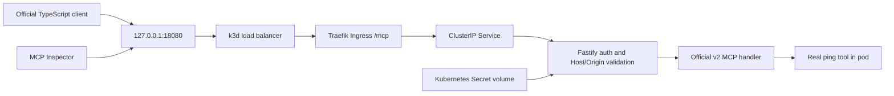

# Architecture through M1

This repository implements a persistent WooCommerce store and the preserved transport proof; the finished gateway remains future work. The full assessment scope is tracked in [REQUIREMENTS.md](../REQUIREMENTS.md). Future-only directories contain explicit unimplemented notices.

The Secret is generated locally, ignored by Git and mounted read-only. Its reference, not its value, appears in the chart. The handler compares the presented bearer credential without logging it. This is a bounded M0 credential test; hashed personal keys, users, teams, revocation and audit remain M3 work. No upstream credential forwarding exists at M0 because there are no upstreams.

The SDK owns Streamable HTTP, discovery, JSON-RPC tools, schemas and modern/legacy wire behavior. A factory creates a fresh server per request. Fastify passes the parsed body to the Node adapter, preventing a second read of the consumed stream. The adapter takes over the response through `reply.hijack()`. Node’s optional method/url declarations are refined from the routed Fastify request without disabling strict checks.

The modern client explicitly chooses automatic era negotiation; a second run explicitly uses legacy negotiation. M0 registers a tool named `ping`; this is not the protocol-level liveness `ping` method. The observed revision/era is recorded in actual client evidence rather than inferred from the package major version.

M0 runs one k3s server inside Docker with a 3 GiB container memory limit, bundled Traefik, local-path storage and Secret encryption enabled. This single-machine proof establishes no HA guarantee. The dedicated kubeconfig does not change the owner’s default context. Only loopback port 18080 is exposed; local HTTP is not claimed to be TLS. Namespace policy permits Traefik and explicitly labelled proof clients, rejects other pod ingress and denies proof-server egress.

Later milestones retain the researched boundaries: React dashboard → control API/session → gateway → handwritten WooCommerce and two independent MCP upstreams; PostgreSQL identity/catalog/audit state; a separate restricted provisioner only at M5. M0 did not implement the store. M1 adds only the store; dashboard, production OAuth, multi-store provisioning and product model chat remain pending.

References: [SDK v2 Fastify integration](https://ts.sdk.modelcontextprotocol.io/v2/serving/fastify.html), [protocol eras](https://ts.sdk.modelcontextprotocol.io/v2/protocol-versions.html), [K3s networking](https://docs.k3s.io/networking/networking-services), [Secret encryption](https://docs.k3s.io/security/secrets-encryption). See exact packages and image identities in [versions.md](../versions.md).

## M1 store path

Browser → loopback k3d port 18080 → Traefik hostname `store.relay.localhost` → store ClusterIP → WordPress/WooCommerce → dedicated MariaDB. WordPress files and database use separate retained PVCs. A post-install/upgrade Helm Job mounts setup Secrets and configures the real store; WordPress runtime mounts DB password/signing salts, with no adapter/admin Secret. Future private adapter gets its own REST Secret.

The local REST verification follows the same Ingress with OAuth HMAC-SHA256 Authorization headers. Canonical hostname/port participate in signature calculation; the command-line client uses `node:http` to preserve Host while connecting to loopback. Node 24's fetch did not preserve that override in the tested path and returned Traefik 404, so it is not used for this test. Native Chrome resolves `.localhost` directly. Real classic checkout creates a WooCommerce HPOS order; administration and REST see the same ID.

The store chart is single-replica, RWO and Recreate. It intentionally uses upstream root initialization and writable image roots; actual process ownership and limits are in M1 inventory. Default-deny namespace policy allows only required DNS/Traefik/own-DB flows. No public database route exists. This is a single-store foundation, not multi-store isolation, database backup/restore or HA. See ADR 0006 and the M1 runbook/evidence. Production same-chart values render, but actual VPS/TLS/amd64 execution remains pending.
