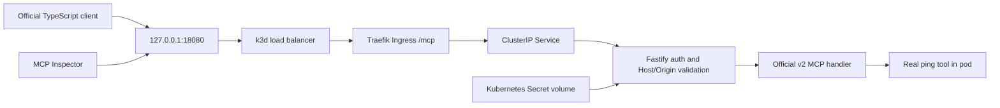

# Architecture through M3

This repository implements a persistent WooCommerce store, three independent private MCP upstreams, the durable authenticated gateway and management API, and the preserved transport proof. PostgreSQL owns identity, registry and audits; Redis enforces shared admission limits. Dashboard and model chat remain M4. The full assessment scope is tracked in [REQUIREMENTS.md](../REQUIREMENTS.md). Future-only directories contain explicit unimplemented notices.

## Preserved M0 transport proof

The following describes the original isolated proof, not the M3 user authentication path.

The Secret is generated locally, ignored by Git and mounted read-only. Its reference, not its value, appears in the chart. The handler compares the presented bearer credential without logging it. This is a bounded M0 credential test; hashed personal keys, users, teams, revocation and audit are now implemented separately in M3. No upstream credential forwarding exists at M0 because there are no upstreams.

The SDK owns Streamable HTTP, discovery, JSON-RPC tools, schemas and modern/legacy wire behavior. A factory creates a fresh server per request. Fastify passes the parsed body to the Node adapter, preventing a second read of the consumed stream. The adapter takes over the response through `reply.hijack()`. Node’s optional method/url declarations are refined from the routed Fastify request without disabling strict checks.

The modern client explicitly chooses automatic era negotiation; a second run explicitly uses legacy negotiation. M0 registers a tool named `ping`; this is not the protocol-level liveness `ping` method. The observed revision/era is recorded in actual client evidence rather than inferred from the package major version.

M0 runs one k3s server inside Docker with a 3 GiB container memory limit, bundled Traefik, local-path storage and Secret encryption enabled. This single-machine proof establishes no HA guarantee. The dedicated kubeconfig does not change the owner’s default context. Only loopback port 18080 is exposed; local HTTP is not claimed to be TLS. Namespace policy permits Traefik and explicitly labelled proof clients, rejects other pod ingress and denies proof-server egress.

Later milestones retain the researched boundaries: React dashboard → control API/session → gateway → handwritten WooCommerce and two independent MCP upstreams; PostgreSQL identity/catalog/audit state; a separate restricted provisioner only at M5. M0 did not implement the store. M1 adds only the store; dashboard, production OAuth, multi-store provisioning and product model chat remain pending.

References: [SDK v2 Fastify integration](https://ts.sdk.modelcontextprotocol.io/v2/serving/fastify.html), [protocol eras](https://ts.sdk.modelcontextprotocol.io/v2/protocol-versions.html), [K3s networking](https://docs.k3s.io/networking/networking-services), [Secret encryption](https://docs.k3s.io/security/secrets-encryption). See exact packages and image identities in [versions.md](../versions.md).

## M1 store path

Browser → loopback k3d port 18080 → Traefik hostname `store.relay.localhost` → store ClusterIP → WordPress/WooCommerce → dedicated MariaDB. WordPress files and database use separate retained PVCs. A post-install/upgrade Helm Job mounts setup Secrets and configures the real store; WordPress runtime mounts DB password/signing salts, with no adapter/admin Secret. Future private adapter gets its own REST Secret.

The local REST verification follows the same Ingress with OAuth HMAC-SHA256 Authorization headers. Canonical hostname/port participate in signature calculation; the command-line client uses `node:http` to preserve Host while connecting to loopback. Node 24's fetch did not preserve that override in the tested path and returned Traefik 404, so it is not used for this test. Native Chrome resolves `.localhost` directly. Real classic checkout creates a WooCommerce HPOS order; administration and REST see the same ID.

The store chart is single-replica, RWO and Recreate. It intentionally uses upstream root initialization and writable image roots; actual process ownership and limits are in M1 inventory. Default-deny namespace policy allows only required DNS/Traefik/own-DB flows. No public database route exists. This is a single-store foundation, not multi-store isolation, database backup/restore or HA. See ADR 0006 and the M1 runbook/evidence. Production same-chart values render, but actual VPS/TLS/amd64 execution remains pending.

## M2 upstream path

A privileged gateway-labelled acceptance pod in relay-platform → ClusterIP Streamable HTTP → separately authenticated Woo/Calendar/Totals deployment. Only Woo → its WordPress service → its MariaDB is permitted. Utilities cannot reach WordPress/DB. No MCP upstream has an Ingress, NodePort, external IP, Kubernetes service-account token or user-session identity. Servers run uid/gid 1000, read-only roots, separate tokens and bounded resources. The Woo adapter alone mounts the existing store-adapter Secret; the fixture client sees only upstream tokens.

Each deployment starts one program from the pinned shared runtime image. The SDK implements stateless modern and legacy MCP; strict Zod contracts, exact decimal/date helpers and a fixed-origin HTTP REST client supply domain behavior. Handwritten Woo tools expose five required operations plus info. Calendar and Totals each provide two useful tools plus info. A pure collision-safe route helper is exercised against all three real info tools, but the dynamic authenticated production gateway is still M3. The actual multi-server SDK sequence is not an autonomous model prompt; that remains M4.

See ADR 0007, the upstream runbook and M2 evidence for actual protocol/security/failure checks. HTTP inside the local cluster is restricted but unencrypted. HTTPS REST configuration, public TLS/VPS and production identity/policy remain unverified work. All full-plan scope remains active.

## M3 platform path

The initial paragraphs above describe preserved milestone snapshots. The production-path implementation now adds: named Ingress → session API or personal-key/delegation gateway → current team/registry/policy and audit admission → official MCP client → chosen private Woo/Calendar/Totals service. PostgreSQL owns identity/teams/keys/registry/catalog/audit; Redis supplies shared admission limits. The API and gateway are separate Kubernetes deployments. PostgreSQL and Redis have PVCs; runtime Secret mounts and one-resource Secret-manager RBAC are distinct from the migration owner.

The API's private delegation route derives identity from Better Auth. The gateway verifies it against current session/membership. The API's private credential route resolves only a team-bound enabled registration's reference. Caller authentication never becomes upstream authentication. Real output/errors are bounded and validated, and a persisted audit correlation accompanies tool results. The dashboard and actual model-driven product chat are M4; the tested trusted delegation foundation is not advertised as a completed chat UI.

See [ADR 0008](../decisions/0008-durable-gateway.md), [local platform runbook](../runbooks/local-platform.md) and [M3 evidence](../evidence/m3.md). All M0–M10, differentiator and expansion scope remains active.
