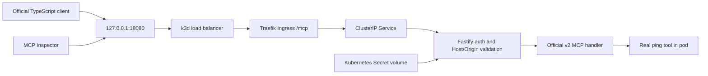

# Architecture at M0

This repository implements a transport proof, not the finished gateway. The full assessment scope is tracked in [REQUIREMENTS.md](../REQUIREMENTS.md). Future-only directories contain explicit unimplemented notices.

The Secret is generated locally, ignored by Git and mounted read-only. Its reference, not its value, appears in the chart. The handler compares the presented bearer credential without logging it. This is a bounded M0 credential test; hashed personal keys, users, teams, revocation and audit remain M3 work. No upstream credential forwarding exists at M0 because there are no upstreams.

The SDK owns Streamable HTTP, discovery, JSON-RPC tools, schemas and modern/legacy wire behavior. A factory creates a fresh server per request. Fastify passes the parsed body to the Node adapter, preventing a second read of the consumed stream. The adapter takes over the response through `reply.hijack()`. Node’s optional method/url declarations are refined from the routed Fastify request without disabling strict checks.

The modern client explicitly chooses automatic era negotiation; a second run explicitly uses legacy negotiation. M0 registers a tool named `ping`; this is not the protocol-level liveness `ping` method. The observed revision/era is recorded in actual client evidence rather than inferred from the package major version.

M0 runs one k3s server inside Docker with a 3 GiB container memory limit, bundled Traefik, local-path storage and Secret encryption enabled. This single-machine proof establishes no HA guarantee. The dedicated kubeconfig does not change the owner’s default context. Only loopback port 18080 is exposed; local HTTP is not claimed to be TLS. Namespace policy permits Traefik and explicitly labelled proof clients, rejects other pod ingress and denies proof-server egress.

Later milestones retain the researched boundaries: React dashboard → control API/session → gateway → handwritten WooCommerce and two independent MCP upstreams; PostgreSQL identity/catalog/audit state; a separate restricted provisioner only at M5. No store, dashboard, production OAuth, multi-store provisioning or model-backed chat is claimed at M0.

References: [SDK v2 Fastify integration](https://ts.sdk.modelcontextprotocol.io/v2/serving/fastify.html), [protocol eras](https://ts.sdk.modelcontextprotocol.io/v2/protocol-versions.html), [K3s networking](https://docs.k3s.io/networking/networking-services), [Secret encryption](https://docs.k3s.io/security/secrets-encryption). See exact packages and image identities in [versions.md](../versions.md).
